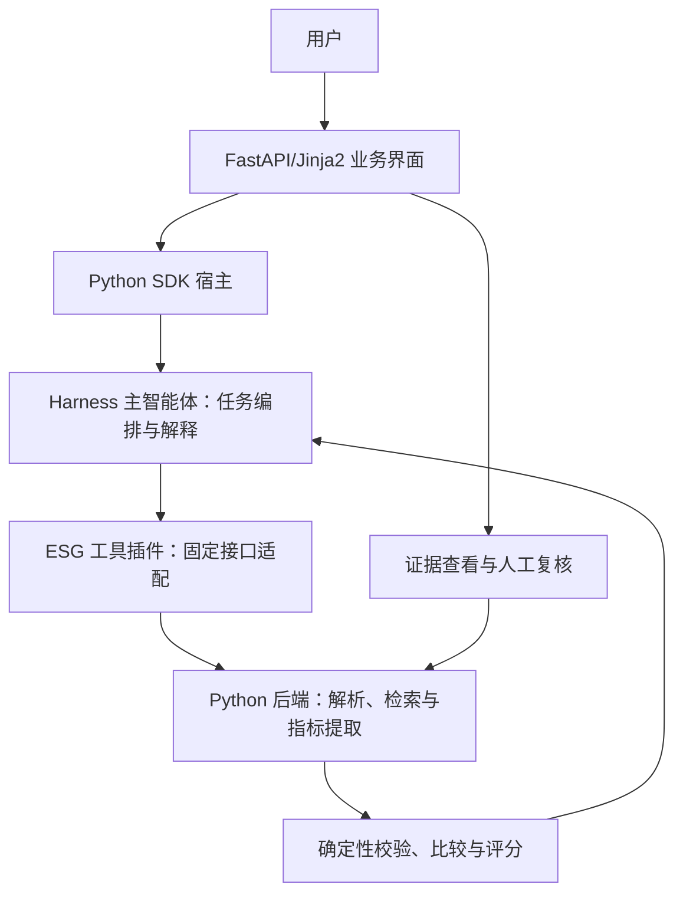

# ESG Agent · 企业环境信息披露质量评估智能体

“智金未来”金融智能体挑战赛小组项目。第一版聚焦碳排放、能源、水资源六项指标，提供原文证据、跨年可比性核查、自建披露质量评分与人工复核。

**当前状态：已合入智能体侧模块与业务页面，并补齐持久解析、业务写入及导出事务；提取器需由后端配置，真实 Harness 整链与第二报告验证尚未完成。**

真实模型与十工具接入、配置及验证边界见[接入说明](docs/live-integration.md)。

业务写入与导出接口、恢复边界见[写入验收说明](docs/write-tool-acceptance.md)。

启动、可信宿主登记与解析验收边界见[parse_report 接入说明](docs/parse-report-acceptance.md)。

## 统一开发入口

业务后端与原前端演示均保留在 `backend/src/esg_app/`，使用不同应用入口：

| 用途 | 启动命令（仓库根目录） | 地址 |
|---|---|---|
| 业务服务与服务端页面 | `.venv/bin/python -m uvicorn esg_app.main:create_app --factory --app-dir backend/src --host 127.0.0.1 --port 8000` | http://127.0.0.1:8000 |
| 三栏前端演示 | `.venv/bin/python -m uvicorn esg_app.frontend_demo:app --app-dir backend/src --host 127.0.0.1 --port 8765` | http://127.0.0.1:8765 |

完整开发环境先运行 `python3 -m venv .venv` 和 `.venv/bin/python -m pip install -e '.[dev]'`。
Windows 将 `.venv/bin/python` 替换为 `.venv\Scripts\python.exe`。
前端演示的分析、问答和评分使用预设数据；本地PDF仅预览，复核状态刷新后重置。
页面详情与独立前端依赖锁见[前端说明](docs/frontend-workbench.md)。

## 从这里开始

1. 阅读[需求文档](项目需求文档.md)与[实现交接文档 v0.3](docs/superpowers/plans/2026-11-19-esg-agent-implementation.md)。
2. 阅读[协作约定](docs/COLLABORATION.md)及[接口约定](contracts/README.md)，认领任务并创建功能分支。
3. 智能体成员从[harness-plugin](harness-plugin/README.md)开始；后端成员从[backend](backend/README.md)开始；资料成员从[测试说明](tests/README.md)开始。

## 目录

| 目录 | 用途 |
|---|---|
| backend/ | Python业务服务：解析、证据检索、模型/规则指标提取、校验、计算、评分 |
| harness-plugin/ | Harness工具适配、任务编排、证据追问与结果解释 |
| contracts/ | 共享接口及明确标记的模拟JSON |
| rules/ | 六指标词典、自建评分配置 |
| tests/ | 测试和人工参考样本 |
| docs/ | 需求、实施方案、协作及验证记录 |

## 统一架构与分工

业务页面通过Python SDK驱动Harness，开发Web UI仅作调试。后端维护指标提取模型/规则、提示词和结果入库；智能体调用extract_metrics取得带证据记录，不再自行生成和提交指标候选。披露检查建议仍由主智能体依据规则提出，分数由后端确定性计算。契约版本0.2.0，评分规则版本独立为disclosure-v0.1。

后端代码统一放在backend/src/esg_app/；根目录保留tests、rules和contracts。Codex固定在codex分支开发并提交PR，其他成员按小组约定使用各自分支。

## 本地启动

实现尚未开始，暂不提供虚构的安装或启动命令。后端和插件实现者应在各目录补充依赖、锁文件、真实启动命令和验证记录。

公开报告请按[来源清单](docs/DATA_SOURCES.md)自行下载至本地data目录。完整PDF、数据库、密钥、候选人材料不提交。

## 评价边界

评价的是选定环境信息的披露质量，不是完整ESG评级或投资价值。缺失不是0；检索失败不是未披露；未知不能自动扣分。评分规则为小组自建试验方案。

本仓库暂未授予统一开源许可；引用第三方代码前核对原许可证并保留来源。是否公开及采用何种许可证由小组另行决定。
