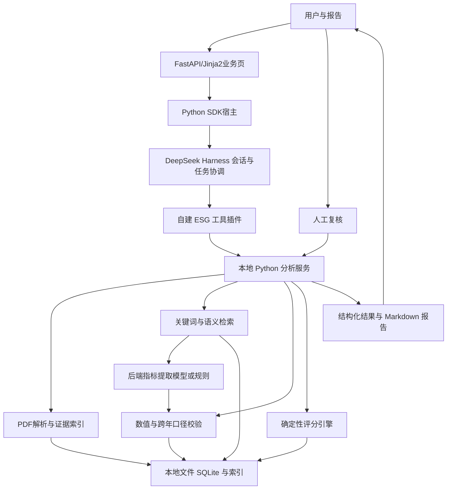

# 企业环境信息披露质量评估智能体项目需求文档

版本：v0.3 调研修订稿\
日期：2026年11月20日\
初赛材料截止日期：2026年12月2日  
拟参赛方向：绿色金融与ESG智能体  
拟采用智能体框架：DeepSeek AI 官方 DeepSeek Harness

## 1. 项目定位

本项目面向金融专业学生和初级研究人员，帮助用户从上市公司公开ESG报告或可持续发展报告中提取环境指标，检查披露完整性、统计口径和跨年可比性，按照公开说明的规则评价披露质量，并生成带有原文证据和改进建议的分析报告。

第一版聚焦环境维度中的碳排放、能源和水资源。项目名称和输出应明确评价范围，不能把环境信息评价称为完整的企业ESG评级。社会和治理维度作为后续扩展。

核心价值：让用户知道报告披露了什么、哪些内容可以比较、哪些问题需要复核，以及每项评价的依据在哪里。

### 1.1 评价对象与边界

- 评价的是选定报告和指标范围内的信息披露质量，不是企业环境表现优劣或投资价值。
- 排放下降不自动加分，排放上升不自动扣分；检查的是相关信息是否充分、清楚、可比较。
- 只能检查已取得资料中的一致性和可核验程度，不能仅凭PDF确认企业底层数据真实。
- 披露不足、未检索到证据和违法、造假、漂绿不是同一结论。
- 第一版是研究与教学用途的辅助工具，保留人工复核。

### 1.2 当前决策状态

| 内容 | 状态 |
|---|---|
| 增加披露质量评估功能 | 纳入核心需求 |
| 采用DeepSeek Harness构建智能体 | 用户提出的初步技术选择 |
| 先做环境维度、六项核心指标 | 本文建议的最小可交付范围 |
| 评分权重、检查项、验收阈值 | 本文建议，需小组及指导老师确认 |
| 具体模型、版本、API费用上限 | 技术预研后确定并记录 |

本文件为需求与技术方案，不表示系统已经实现、测试或部署。

## 2. 用户与使用场景

### 2.1 目标用户

1. 金融专业学生：快速阅读报告，理解指标口径和披露质量。
2. 初级研究人员：整理跨年数据，定位证据，发现需要进一步核查的问题。

### 2.2 核心场景

**场景A：单份报告评估。**用户导入一份中文报告，确认企业、报告年度和评价范围。系统提取指标并检查披露质量，返回分项结果、证据、问题清单和报告。

**场景B：同一企业跨年核查。**用户导入同一企业两年报告，系统对齐指标、单位、核算范围与年度，判断是否可比。只有可比数据才计算同比；存在重述、边界差异或缺失时先说明限制。

**场景C：证据追问。**用户问“为什么这一项扣分”“数据来自哪一页”“为什么不能直接比较”。系统根据已存证据回答，并支持打开对应PDF页面。

## 3. 第一版范围与优先级

P0为12月2日前应完成的核心范围；P1为P0稳定后再做；P2不计入本轮交付。

| 优先级 | 功能 | 最小交付内容 |
|---|---|---|
| P0 | 报告导入与登记 | 中文PDF、企业及年度确认、来源与文件版本记录 |
| P0 | PDF解析与证据索引 | 保留原始页码、段落、表格、脚注及来源关系 |
| P0 | 六项环境指标提取 | 结构化数据、原文证据、单位、年度、边界及状态 |
| P0 | 披露质量评估 | 固定规则、分项得分、扣分依据、未知项和复核入口 |
| P0 | 跨年核查与计算 | 同企业指标对齐、口径检查、可比数据同比 |
| P0 | 报告与追问 | Markdown分析报告、数据CSV、证据问答 |
| P0 | 人工复核与记录 | 修改结果保留理由与版本；修改后重新计算 |
| P2 | 扫描件和复杂表格增强 | OCR与视觉解析，低质量结果提示复核 |
| P1 | 外部事件交叉核查 | 少量人工确认的公告或事件，展示来源与时间 |
| P1 | 图表及多企业对照 | 指标趋势、分项得分；仅在同一规则和适用范围下比较 |
| P2 | 全ESG覆盖 | 社会、治理指标及行业差异化框架 |
| P2 | 自主训练与大规模采集 | 新训练评分模型、全市场覆盖、实时新闻监控 |

第一版不依赖WRDS完整版ESG数据库；已有权限主要为相关样例产品，正式案例优先使用公开报告。

## 4. 基本功能需求

### F01 报告导入

- 支持本地导入中文PDF。第一版优先支持具有可复制文字层的报告。
- 用户确认企业名称、报告年度、报告类型和来源链接；企业年度由系统建议、用户确认。
- 报告年度与发布日期分开记录，例如2024年度报告可能于2025年发布。
- 生成文档ID与文件哈希，同一文件重复导入时提示复用解析结果。
- 每个分析任务明确选择一份或两份报告；跨企业比较不属于P0。
- 建议初始限制：每份不超过50MB、300页，每个任务最多两份；超限应明确告知。
- 加密、损坏、纯扫描或部分不可解析文件应显示具体状态，不能静默当作空白报告。

### F02 文本、表格与脚注解析

- 逐页解析，保留PDF物理页码；印刷页码能识别时另存，不能识别时允许为空。
- 数值必须保留行标题、列年份、单位和相邻脚注，不能将表格只当作无序文本。
- 原始文本和数值不得被预处理覆盖；单位转换另存结果与换算依据。
- 对“/”“—”“未统计”“不适用”等原始表达分别保留，不得一律转换为0。
- 检测缺页、低质量解析和表格错列；影响指标判断时进入待复核状态。
- 缓存解析结果；仅修改评分规则时不应重新解析全部PDF。

### F03 六项核心指标

| 指标ID | 指标 | 必须保留的说明 |
|---|---|---|
| E01 | 范围1+范围2温室气体排放量 | 二氧化碳当量单位、范围、年度；若由分项相加需标为计算值 |
| E02 | 范围1+范围2温室气体排放强度或密度 | 分母及其数量级，如万元营收；不能误写成每辆车排放 |
| E03 | 范围3温室气体排放量 | 披露了哪些类别、哪些范围未知，不能自动解释为完整价值链 |
| E04 | 能源总耗量 | 原始单位与能源构成；换算口径不清时不强行统一 |
| E05 | 总取水量 | 指标定义、统计范围，区分取水、排水和耗水 |
| E06 | 总耗水量 | 是否直接披露、是否由取水减排水计算及相应依据 |

- 单份报告可能包含多个年度，指标所属年度应逐条识别，不得全部沿用报告年度。
- 原始披露值、系统计算值和人工修订值必须可区分。
- 同一指标存在不同口径或冲突数值时，保留候选及来源，不静默选取其中一个。
- 抽取不到时保留状态，不能编造数值补齐表格。

### F04 证据检索与追溯

- P0采用指标别名与全文索引检索，针对每项指标寻找对应段落、表格和脚注；P1再增加语义检索，保持search_evidence接口不变。
- 输出结论必须关联真实存在的证据ID；后端验证ID归属当前任务和文档。
- 用户可以从指标或检查项打开PDF页面，并查看相应原文；首版可先实现页面跳转与原文对照。
- 页内高亮为P1，不作为P0阻塞项。
- 模型生成的解释不是新的原始证据。
- 未检索到时执行一次有界补充检索；仍无结果则标为待复核。

### F05 披露质量评估

按照第5节规则评价所选环境信息，输出评分框架版本、适用检查项、分项得分、待复核项、证据与改进建议。不得仅凭模型自由生成一个总分。

### F06 跨年核查

- 检查企业、指标定义、单位、年度、统计边界与计算方法是否一致。
- 同时存在上年原始报告与本年重述数据时，保存两种版本；经确认优先使用可比重述序列，并说明原因。
- 可以确认可比时，使用确定性计算工具计算：同比变化率＝（本期值－上期值）÷上期值×100%。
- 上期值为0、缺失、无法确认口径或单位不能换算时，不返回普通同比百分比。
- 强度指标应同时展示分母；百分比指标的相对变化与百分点变化分开命名。
- 自动发现的口径差异是核查线索，不直接认定披露存在错误。

### F07 分析报告

报告至少包含：评价对象与资料版本、分析范围、指标证据表、跨年比较、分项评分、未知项、主要核查问题、改进建议、金融意义、方法和局限。

金融意义应解释信息不足可能如何影响成本、经营或融资风险判断；没有额外证据时，只能描述可能路径，不能编造财务影响金额或因果结论。

P0导出Markdown报告和CSV数据表。建议Markdown报告约1500—2500字，表格及证据索引不计；不要求自动生成PPT或复杂PDF。

### F08 人工复核

- 用户可以确认、驳回或修改指标、适用性及检查项状态。
- 修改须记录原值、新值、理由、引用证据、时间和复核人标识。
- 得分由规则引擎重算；模型或用户不能只修改总分而不修改底层依据。
- 复核前后结果均保留，导出时注明是否经过人工复核。
- 原型可由单人完成复核，不要求第一版实现多人审批系统。

## 5. 披露质量评分需求

### 5.1 依据与命名

采用“标准原则与具体披露要求提供依据、模型定位证据、程序计算分数”的方法。GRI报告原则可作为方法依据，具体检查项应同时记录适用标准、条款、版本与适用理由。

以下是项目自建研究框架的建议，不是GRI、交易所或评级机构发布的官方百分制模型。第一版应命名为“环境信息披露质量评估 v0.1”。使用交易所规则时须匹配上市地点、报告年度和生效时间，不能把最新规则追溯认定为旧报告的强制要求。

### 5.2 建议维度和检查项

每个维度设置4个检查项，同维度内等权。以下问题仅针对已选择的六项指标和相关目标，不声称覆盖全部环境议题。

| 维度 | 权重 | 首版检查内容 |
|---|---:|---|
| 披露完整性 | 25% | 碳排放量及强度是否提供；范围3覆盖情况是否交代；能源总量是否提供；取水和耗水是否分别提供。缺少数值但说明原因，按预设锚点评价 |
| 量化与具体性 | 20% | 数值与单位是否明确；年度是否明确；强度分母是否明确；原始缺失、零和估算表达是否清楚 |
| 边界与方法透明度 | 20% | 组织或场所范围是否说明；核算方法或引用是否说明；重要因子或换算依据是否可查；估算与排除事项是否解释 |
| 跨年可比性 | 20% | 是否提供可用历史信息；单位与定义是否一致；边界或方法变化是否解释；重述情况或缺乏可比性的原因是否交代 |
| 目标与进展可追踪性 | 15% | 基准是否明确；目标时间是否明确；目标类型及范围是否明确；进展及评价依据是否提供 |

开发前将每项问题写入规则文件，定义“充分、部分、不满足”的具体条件与示例。复合检查项必须列出子条件，不能留给模型随意解释。指标适用性结合行业和报告范围确定，不能因为企业未披露就自动认定不适用。

### 5.3 单项状态

| 状态 | 数值 | 处理要求 |
|---|---:|---|
| 充分满足 `met` | 1 | 有足够证据，满足该项预定义条件 |
| 部分满足 `partial` | 0.5 | 仅满足预定义的部分条件，列出缺失内容 |
| 不满足 `not_met` | 0 | 证据显示不满足，或人工复核确认相关要求确实未披露 |
| 待复核 `unknown` | 不赋分 | 检索不足、解析问题、冲突或无法判断，不能按0分处理 |
| 不适用 `not_applicable` | 不进入分母 | 给出适用性依据并由人工确认 |

自动检索失败必须保持为`unknown`，不能由模型自行改为`not_met`。复核确认未披露后才可按该项规则计分。

### 5.4 汇总、覆盖率与不确定性

设检查项权重为a_i（维度权重除以4），A为适用项集合，K为已判定的适用项集合。

- 评价覆盖率：C＝Σ(K中a_i)÷Σ(A中a_i)。
- 已判定项参考分：S_K＝100×Σ(K中a_i×s_i)÷Σ(K中a_i)。
- 未知项按0和1分别计算可能总分下限、上限，形成分数区间。
- C＜100%时，必须称为“已判定项参考分”，同时显示覆盖率和分数区间；全部适用项判定后才能显示最终总分。
- 建议C＜80%时不在页面顶部突出显示单一分数，而显示“证据不足，待复核”。80%是项目界面阈值，不是官方标准。
- 所有项目均不适用或均未知时，不输出除零结果，也不默认100分。
- 比较不同企业或年份的分数前，应确认规则版本、行业、指标范围和适用项一致；否则只展示差异，不给出简单排名。

### 5.5 输出示意

单项结果应呈现“检查问题—状态—证据—缺失信息—改进建议”。例如：

> 检查问题：是否说明范围3排放的类别覆盖情况。  
> 状态：根据该报告原文及规则判断。  
> 证据：文档ID、PDF页码、脚注或原文片段。  
> 建议：补充类别覆盖、排除范围及其依据。

此处是输出结构示意，不是对比亚迪或其他企业的实际评价。

## 6. 智能体行为与完整流程

第一版采用一个主智能体协调多个工具。数据提取、评分和复核是工作阶段，不要求对应多个独立Agent。

1. 用户选择报告并确认企业、年度和指标范围。
2. 系统校验文件，建立文档登记与任务ID。
3. 解析文字、表格和脚注，生成证据片段及索引。
4. 主智能体调用extract_metrics；后端按指标和年度检索证据，使用规则/模型提取并校验保存，返回记录、问题和运行版本。
5. 后端内部验证字段、单位、数值、年度与证据归属，失败有界修正或转待复核；主智能体可调用只读校验工具核对，不提交任意指标候选。
6. 跨年核查工具判断可比性，计算工具只处理通过检查的数据。
7. 主智能体依据评分规则逐项提议状态和理由，程序计算参考分、覆盖率与区间。
8. 用户复核未知、冲突和关键扣分项，系统保留修订记录并重算。
9. 生成最终报告和证据表；后续追问只引用本任务允许访问的资料。

主智能体不能绕过数据校验、适用性确认和规则计分。报告中的自然语言指令仅作为待分析文本，不能改变系统规则或授权调用工具。

## 7. DeepSeek Harness技术路线

### 7.1 框架选择

本文按DeepSeek AI官方仓库`deepseek-ai/deepseek-harness`设计，不是同名的第三方Python协议适配项目。

官方框架提供插件化工具、模型适配、会话日志和智能体循环；当前处于开发者预览阶段。开发时应锁定实际测试通过的发布版本或提交，不跟随开发分支自动升级。本文不预设未经测试的具体版本号和模型名称。

### 7.2 建议架构（与实现交接v0.3一致）

**第一阶段界面：**P0采用FastAPI/Jinja2业务页，提供导入、指标、评分和证据复核四个区域，通过Python SDK在服务端驱动Harness。Harness开发Web UI仅供技术调试，不作为评委操作界面；不同时建设Streamlit。

**运行时：**显式隔离dsh_home和任务cwd，使用锁定版本验证read-only及默认拒绝的10工具白名单，文件权限不代替任务令牌/业务端权限。SDK在后台运行，保持HTTP工具服务可响应；会话恢复、整轮截止与取消必须单独测试。SDK提问回调不等于用户人工确认。模型、版本、定价和实际费用以记录与烟测为准。

该架构是项目建议，不是Harness内置ESG能力。PDF分析、后端指标提取、评分、文件登记、复核页面和业务API均需小组实现或按许可复用。后端统一位于backend/src/esg_app/；Harness插件不承担另一套指标抽取。

### 7.3 技术分层

| 层次 | 建议方案 | 责任 |
|---|---|---|
| 智能体运行 | Python SDK驱动DeepSeek Harness | 会话、任务推进、工具调用、运行日志；隔离配置与新建/恢复权限实测 |
| 主智能体模型 | Harness中测试通过的模型 | 调用工具、提议检查状态、解释与证据问答 |
| 后端提取模型/规则 | 由业务端配置并测试，记录独立版本 | 指标结构化抽取、有界修正、证据关联与输出校验 |
| 工具桥接 | TypeScript自建插件 | 注册受控ESG工具，调用本地分析服务 |
| 业务服务 | Python、FastAPI、Pydantic | 解析检索、指标提取、存储、业务API、结构校验与错误状态 |
| 报告解析 | P0采用pdfplumber/pypdf文字层解析；复杂页另评估OCR | 保存页码、表格、脚注及原始文本；许可需随依赖一并核对 |
| 检索 | P0指标别名＋SQLite全文索引，P1再评估向量检索 | 召回指标证据，不能把语义模型列为首版必要依赖 |
| 数值处理 | Decimal及显式单位映射 | 数值解析、单位转换、同比，避免模型口算 |
| 评分 | 独立Python规则模块＋版本化YAML/JSON | 计算检查项、权重、覆盖率、区间与总分 |
| 存储 | 本地文件、SQLite；向量索引按需选用 | 原始资料、任务、指标、规则和复核记录 |

不要求首版部署大型GPU推理服务。模型API、解析器和嵌入模型能否在现有设备运行，需要预研实测；费用上限由小组设定。

### 7.4 拟定义的领域工具

以下是拟注册的10个领域工具，不是已经存在的Harness能力；精确字段以contracts/v0.2.0为准。

| 工具 | 主要输入 | 主要输出 |
|---|---|---|
| parse_report | task_id、expected_revision | 解析状态、证据索引和问题页 |
| extract_metrics | task_id、expected_revision、metric_ids、years | 后端提取/校验/保存的指标、证据、issues及run元数据 |
| search_evidence | task_id、query、metric_id可选 | 原文、证据ID、页码与关联脚注 |
| get_rulebook | task_id | 当前固定规则、锚点与权重 |
| validate_metrics | task_id、record_ids | 字段、冲突与边界问题 |
| compare_years | task_id、expected_revision、两个记录ID | 比较状态、同比或拒绝原因 |
| save_check_proposals | task_id、expected_revision、checks | 校验后的披露检查建议 |
| calculate_score | task_id | 固定规则计算的分数、覆盖率与区间 |
| get_task_results | task_id | 当前结果、问题、版本及提取运行记录 |
| export_analysis | task_id、expected_revision | 同版本Markdown、CSV和JSON |

用户登记和人工复核由网页处理。MetricCandidate只在后端提取模型边界使用，不暴露给主Agent写入；主Agent不另建抽取实现。后端负责提取模型提示词与预算，智能体成员负责工具适配及编排。评分仍是自建试验框架，不接受模型任意权重或总分。

### 7.5 接入原则

- 按官方工具文档使用`defineTool`与`ctx.tools.register`注册领域工具，返回可校验的结构化结果。
- 插件只允许访问项目分析服务、当前任务资料和指定输出目录。
- 不为普通报告分析开放任意Shell、任意路径写入或任意外部URL访问。
- 任务ID、报告ID与证据ID在服务端检查；不能只依赖提示词限制越权读取。
- 主智能体决定调用、检查建议及解释；业务后端负责指标提取模型/规则、证据校验、存储、计算和规则执行。
- 每项工具有超时、取消与错误码；建议自动重试最多2次，仍失败则进入可见错误状态。
- 具体配置字段以锁定版本的官方文档为准，接入前完成最小工具调用试验。

## 8. 核心数据要求

### 8.1 报告与证据

- 报告：文档ID、文件哈希、企业、报告年度、发布日期、来源URL、文件路径、解析版本。
- 证据：证据ID、文档ID、PDF页码、印刷页码（可空）、原文、类型、表格行列、脚注关联。
- 保留原始PDF；所有生成文本应可以回到原始资料。

### 8.2 指标记录

至少包含：指标ID、企业、指标年度、原始数值字符串、解析数值、原始单位、标准单位、换算规则、组织范围、业务范围、核算方法、范围3类别、证据ID、状态和版本。

数值使用十进制定点表达存储，未知值为`null`，原始“/”等符号另存；不使用0代替未知。

### 8.3 检查项与复核

至少包含：规则ID与版本、依据条款、问题、适用性、状态、分值、证据ID、理由、缺失信息、改进建议、自动/人工标识和修订历史。

模型自报“置信度”不能直接作为正确概率。首版用可解释状态与证据展示可靠性，统计可靠性由验证集评估。

## 9. 界面与交互要求

1. 导入与任务页：选择报告、确认企业年度与范围，显示处理阶段及错误。
2. 指标页：展示六项指标、年度、单位、边界和出处，明确待复核状态。
3. 评分页：展示五个维度、覆盖率、未知项与扣分依据；区分参考分和最终分。
4. 证据与复核页：原文/表格与PDF页对照，记录人工修改理由。
5. 分析报告与问答：导出文件，对结论继续追问。

首版可以将以上区域整合在Harness会话、生成报告及简易复核页面中，不要求五个独立页面。用户界面使用业务语言，不展示内部工具参数、异常堆栈或模型密钥。

## 10. 非功能要求

- **一致性：**相同已确认输入、相同规则版本的计算结果一致；模型变化不影响确定性计算。
- **可恢复：**解析、抽取、评分分阶段存储；评分失败不删除已成功的证据。
- **可追溯：**每次分析记录资料、规则、解析器、模型、提示词版本及调用时间。
- **性能：**优先保证正确；预研测量一份比亚迪报告的处理时间、费用与内存，再设定运行目标，不提前宣称秒级或高并发。
- **资源：**模型调用次数、并发和任务费用设置上限；缓存可复用结果。
- **数据控制：**只使用公开或获得授权的材料；商业数据库数据进入模型前单独核对许可。
- **密钥保护：**密钥置于环境或受控配置，不写入代码、导出报告或演示视频。
- **提示词注入防护：**报告与网页内容不能更改评分规则、要求发送文件或获取其他任务资料。
- **原创性：**列出开源依赖、复用模块、许可证及本组新增工作，保留必要版权和修改说明。

## 11. 测试与验收

以下为建议的第一版验收目标，实际结果必须测试后填写，不作为已经达到的性能承诺。

### 11.1 验证资料

- 建议准备同一行业3家企业、各两年的公开报告，以实际可获取材料为准。
- 建立30—50条指标抽取样本，涵盖数值、单位、年度、边界与出处。
- 另对至少3份报告形成20项检查的人工参考评价，不用指标样本替代评分验证。
- 两名成员先独立标注，再讨论分歧并记录；保留一份未用于调整提示词的报告用于最终检查。
- 人工金标准允许未知和不适用状态，不能为了凑完整答案补造信息。

### 11.2 验收表

| 验收项 | 建议要求 |
|---|---|
| 流程完整 | 演示案例完成导入、抽取、核查、评分、人工复核和导出 |
| 指标抽取 | 人工确认可提取样本中，数值、单位、年度均正确的记录占比目标≥90%；报告错误与遗漏的具体数量 |
| 证据定位 | 输出的指标和评分结论均有有效证据或明确待复核状态；抽查原文与引用对应率目标≥95% |
| 关键边界 | 缺失不当零、上年为零不算普通同比、不可比不强算、未知不直接扣分，指定案例全部通过 |
| 确定性评分 | 固定检查项状态输入的计算结果全部与手算一致，包括未知、不适用和全未知情况 |
| 模型与人工 | 逐项状态完全一致率目标≥80%；分别报告分歧、未知比例和人工复核后的结果 |
| 修订追溯 | 任意人工修改可查旧结果、理由和重算后的分数 |
| 失败可见 | 文件损坏、缺页、超时、无效JSON不显示为成功或未披露 |
| 导出 | Markdown和CSV可正常打开，内容与界面同一版本一致 |

抽取指标同时报告漏提率，避免通过只输出少量容易样本提高正确率。评分一致率在两方均已判定的共同适用项上计算，同时单独报告系统未知率；不能靠大量弃答宣称高可靠性。

### 11.3 建议演示案例

使用已下载的比亚迪2024年度可持续发展报告，演示六项指标提取与证据跳转、一个跨年口径问题、五维评分中的未知项，以及一次人工复核后重算。企业实际得分须运行并复核后生成。

## 12. 小组分工与阶段交付

| 角色 | 负责内容 | 必须交付 |
|---|---|---|
| 队长/后端协调 | 场景、金融逻辑、后端提取与校验计算、评价规则、申报材料 | 后端能力、需求与规则、申报书和视频脚本 |
| 智能体成员 | Harness接入、工具插件、任务编排、检查建议、证据问答与联调 | 可调用后端的Agent、工具说明、运行记录 |
| 资料验证成员 | 报告收集、人工标注、来源核对、复测 | 资料目录、参考答案、错误清单与验证结果 |

| 时间 | 阶段目标 |
|---|---|
| 11.18—11.19 | 确定范围与分工；完成Harness框架确认和解析可行性检查 |
| 11.20—11.21 | 锁定首版规则与字段；跑通单份报告提取 |
| 11.22—11.23 | 完成跨年核查、计算及评分最小流程 |
| 11.24—11.25 | 集成完整流程，准备人工验证集，完成申报书框架 |
| 11.26—11.27 | 修复关键错误、复测并完成申报书初稿 |
| 11.28—11.29 | 指导意见修订、数据复核与演示试录 |
| 11.30—12.01 | 冻结功能，完成申报书、正式视频和备份 |
| 12.02 | 检查问卷、附件及命名，提交并保存凭证 |

外部新闻、复杂扫描件和图谱均不能挤占P0的验证时间。评分规则与证据可靠性优先于界面美化。

## 13. 初赛提交物

按用户提供的挑战赛方案准备：团队报名问卷、项目申报书、原型系统或演示材料。演示视频不超过2分钟、不超过300MB；截止时间为2026年12月2日。

项目自身还应保留：可运行原型、规则文件、公开案例、人工验证集、实际测试结果、参考来源与依赖许可说明。原型和材料应明确哪些能力已实现、哪些仍为后续计划。

## 14. 小组近期需确定的事项

1. 是否接受本文建议的“环境维度＋六指标＋五维评分”首版范围。
2. 请指导老师审阅检查项、权重、适用性与标准版本映射。
3. 技术成员验证Harness最小工具调用，记录版本、设备、模型和API费用上限。
4. 确定首批企业报告和最终留出的测试报告。
5. 确定使用Harness会话＋简易复核页面，还是在不影响P0的前提下增加专用界面。

以上事项不阻碍先做公开报告登记、原文标注和最小技术预研。

## 15. 官方技术资料与参考项目

资料核查日期：2026年11月18日。引用项目不意味着其代码、数据和模型采用同一许可，复用时按实际文件核对。

### 15.1 DeepSeek Harness官方资料

- [官方仓库及开发者预览说明](https://github.com/deepseek-ai/deepseek-harness)
- [中文架构说明](https://github.com/deepseek-ai/deepseek-harness/blob/master/docs/architecture.zh.md)
- [工具编写与注册参考](https://github.com/deepseek-ai/deepseek-harness/blob/master/docs/cookbook/adding-a-tool.zh.md)
- [Web UI使用指南](https://github.com/deepseek-ai/deepseek-harness/blob/master/docs/user/guide/index.zh.md)
- [官方Python SDK](https://github.com/deepseek-ai/deepseek-harness/blob/master/python/sdk/README.md)

### 15.2 评分与研究参考

- [GRI 1 Foundation 2021](https://www.globalreporting.org/publications/documents/english/gri-1-foundation-2021/)：报告质量原则依据；不直接提供本文的权重和百分制。
- [ChatReport](https://github.com/EdisonNi-hku/chatreport)：证据问答及逐项披露评价方法参考。
- [Corporate Sustainability Tracker](https://github.com/forsterkerstin/corporate-sustainability-tracker)：指标提取、单位后处理与人工验证参考。
- [EulerESG](https://github.com/RAIDSLab/EulerESG)：指标、证据和跨报告比较的数据结构参考；不计划整体照搬部署。
- [中文ESG-dataset](https://github.com/LCYgogogo/ESG-dataset)：中文议题分类辅助材料，不能替代数值提取金标准。
- [Climate Finance Bench](https://github.com/Pladifes/climate_finance_bench)：检索问答评测设计参考。

### 15.3 首批案例

- [比亚迪2024年度可持续发展报告原始披露文件](https://static.cninfo.com.cn/finalpage/2025-03-25/1222881489.PDF)
- 工作区资料：`队友筛选/发给候选人/比亚迪_2024年度可持续发展报告.pdf`。
- 竞赛要求来源：用户提供的《“智金未来”金融智能体挑战赛方案》。正式提交前由队长核对赛事通知与模板是否更新。
